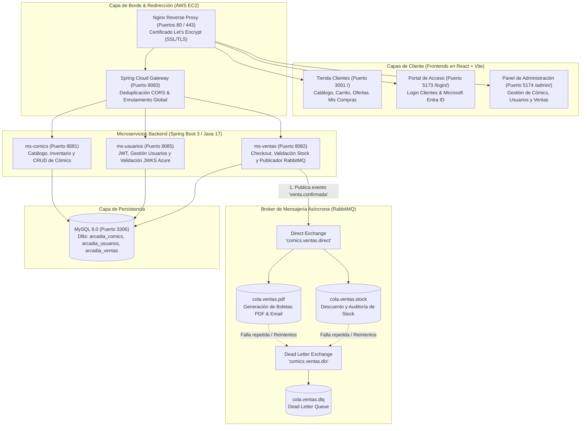

# 📚 Arcadia Comics — Ecosistema Cloud Native & Event-Driven

[](https://spring.io/projects/spring-boot)
[](https://react.dev/)
[](https://www.rabbitmq.com/)
[](https://www.mysql.com/)
[](https://azure.microsoft.com/)
[](https://aws.amazon.com/ec2/)
[](https://letsencrypt.org/)

Ecosistema integral de comercio electrónico de cómics construido bajo una **arquitectura de microservicios desacoplada y orientada a eventos (EDA)**. Implementa procesamiento asíncrono de órdenes con **RabbitMQ**, autenticación federada con **Microsoft Entra ID (Azure AD)**, API Gateway reactivo, orquestación con **Docker Compose** y despliegue en la nube sobre **AWS EC2** bajo dominio seguro **HTTPS**.

🌐 **Despliegue en Vivo:** [https://arcadia-comics.duckdns.org](https://arcadia-comics.duckdns.org)

---

## 🏛️ Arquitectura Global del Sistema



---

## ✨ Características Personalizadas & "Customs" Implementados

El proyecto incorpora un conjunto integral de reglas de negocio y mejoras de experiencia de usuario diseñadas a medida:

### 1. 📚 Catálogo Centralizado y Dinámico (32 Cómics Reales)
- Los cómics se almacenan y consumen en vivo desde la base de datos relacional MySQL (`ms-comics`).
- Sembrado automático garantizado: no depende de estados estáticos y se sincroniza al arrancar.

### 2. 🌟 Carrusel de "Ofertas del Mes" con Compra Rápida
- Ubicado en la parte superior de la tienda principal.
- Presenta cómics destacados con descuentos exclusivos, temporizador y botón de compra directa al carrito.

### 3. 🔢 Paginación de a 8 Cómics con Botón "Ver más"
- La grilla inferior organiza el catálogo en bloques iniciales de **8 cómics**.
- Botón interactivo: `Ver más cómics (X restantes) ↓`, permitiendo una carga visual fluida y sin saturación.

### 4. 🛡️ Control Estricto de Stock Preventivo
- Los cómics sin existencias (Stock: 0) se destacan con estilo desactivado y etiqueta visible `Agotado (0)`.
- **Validación en dos niveles:**
  1. **Frontend:** Bloqueo inmediato al intentar añadir al carrito o realizar la compra sin pasar datos inválidos a la cola.
  2. **Backend:** Validación en `ms-ventas` antes de confirmar la persistencia y antes de emitir a RabbitMQ.

### 5. 🌙 Modo Oscuro y Modo Claro Accesible
- Conmutador integrado en la barra de navegación accesible desde cualquier pantalla.
- Paleta optimizada para legibilidad y descanso visual, con persistencia automática en `localStorage`.

### 6. 🔐 Autenticación y Roles Diferenciados
- **Pestaña Clientes:** Formulario normal con correo electrónico y contraseña, enlace a registro de nuevos usuarios y botón de acceso rápido demo.
- **Pestaña Administradores:** Exclusiva para el equipo de gestión con el botón oficial de **Microsoft Entra ID (Azure AD)** y validación de tokens institucionales.

### 7. 📦 Módulo "Mis Compras Recientes" (`/mis-compras`)
- Vista dedicada para que el cliente consulte sus adquisiciones previas.
- Información en tiempo real: número de orden (`#ORD-...`), fecha, estado (`✅ Pago Confirmado`), desglose de cómics con portada, cantidad y total pagado en pesos chilenos ($ CLP).

### 8. ⚙️ Panel de Administración Integral (`/admin/`)
- Métricas en tiempo real de usuarios registrados, inventario y ventas acumuladas.
- **CRUD de Cómics:**
  - **Añadir:** Formulario con selector de género, sinopsis, instrucciones claras para copiar enlaces web (.jpg, .png, .webp) y **vista previa en tiempo real de la portada**.
  - **Editar:** Modificación inmediata de precios, stock, descripciones o portadas.
  - **Eliminar:** Confirmación de seguridad previa a la baja del catálogo.
- **Gestión de Usuarios:** Filtro entre usuarios con Microsoft Entra ID y usuarios locales, visualización de roles y estado de conexión en vivo.

---

## 🐰 Topología y Flujo de Mensajería con RabbitMQ

El flujo de compras sigue el patrón **Event-Driven Architecture (EDA)** para asegurar alta disponibilidad y desacoplamiento:

1. **Exchange Principal:** `comics.ventas.direct` (Direct Exchange durable).
2. **Routing Key:** `venta.confirmada`.
3. **Colas Durables:**
   - `cola.ventas.pdf`: Consumida por `PdfReceiptConsumer`, maquetando una boleta PDF electrónica en memoria con `OpenPDF` y simulando el despacho por correo mediante `JavaMailSender`.
   - `cola.ventas.stock`: Consumida por `StockUpdateConsumer`, descontando el inventario adquirido en la persistencia con auditoría.
4. **Dead Letter Exchange (DLX):** `comics.ventas.dlx`.
5. **Dead Letter Queue (DLQ):** `cola.ventas.dlq` (almacena mensajes con fallos repetidos para inspección manual sin bloquear la operativa del negocio).
6. **Gestión Programática (RabbitAdmin):** Endpoints REST bajo `/api/rabbitmq/**` para declarar, purgar, monitorear y eliminar colas y exchanges en caliente.

---

## 🛠️ Tecnologías Utilizadas

| Capa | Tecnología |
| :--- | :--- |
| **Frontend** | React 18, Vite, Tailwind CSS, Lucide Icons, MSAL React (`@azure/msal-react`) |
| **Backend** | Java 17, Spring Boot 3.2.5, Spring Cloud Gateway, Spring AMQP, Spring Security |
| **Mensajería** | RabbitMQ 3.13 con RabbitAdmin y Jackson2JsonMessageConverter |
| **Persistencia** | MySQL 8.0, Spring Data JPA, Hibernate, HikariCP |
| **Generación PDF** | OpenPDF (LibrePDF) en memoria |
| **Identidad / Auth** | Microsoft Entra ID (Azure AD), JWT (JSON Web Tokens), BCrypt |
| **Infraestructura** | Docker, Docker Compose, Nginx, Certbot (Let's Encrypt), AWS EC2 (Ubuntu 24.04 LTS), DuckDNS |

---

## 🚀 Despliegue y Ejecución Local

### Prerrequisitos
- Docker Engine y Docker Compose instalados.
- JDK 17 y Node.js 20+ (opcional para desarrollo sin contenedores).

### Pasos para levantar todo el ecosistema con Docker:

```bash
# 1. Clonar el repositorio
git clone -b v2 https://github.com/LarviNa/ArcadiaMaster.git
cd ArcadiaMaster

# 2. Levantar todos los servicios (Base de datos, RabbitMQ, Microservicios y Frontends)
docker compose up -d --build

# 3. Verificar estado de los contenedores
docker compose ps
```

### URLs de Acceso Local:
- **Tienda de Cómics:** `http://localhost:3001`
- **Portal de Login:** `http://localhost:5173`
- **Panel de Administración:** `http://localhost:5174`
- **API Gateway:** `http://localhost:8083`
- **RabbitMQ Management:** `http://localhost:15672` (Usuario: `guest` / Clave: `guest`)

---

## 📡 Endpoints de la API REST

### Microservicio Cómics (`ms-comics` / Gateway: `/api/comics`)
- `GET /api/comics`: Listado completo de cómics del catálogo.
- `GET /api/comics/{id}`: Detalle de un cómic por ID.
- `POST /api/comics`: Crear nuevo cómic (requiere rol Admin).
- `PUT /api/comics/{id}`: Actualizar datos de un cómic existente.
- `DELETE /api/comics/{id}`: Eliminar cómic del catálogo.

### Microservicio Usuarios (`ms-usuarios` / Gateway: `/api/usuarios`)
- `GET /api/usuarios/health`: Estado de salud del microservicio.
- `POST /api/usuarios/registro`: Registro de nuevos usuarios locales.
- `POST /api/usuarios/login`: Autenticación con credenciales locales.
- `POST /api/usuarios/azure-login`: Validación y aprovisionamiento con Microsoft Entra ID.
- `GET /api/usuarios`: Listado de usuarios registrados (Admin).

### Microservicio Ventas & RabbitMQ (`ms-ventas` / Gateway: `/orders`, `/api/rabbitmq`)
- `POST /orders/checkout`: Procesar orden de compra y emitir evento a RabbitMQ.
- `GET /orders/user-orders`: Historial de pedidos por usuario o email de cliente.
- `GET /orders/history/{userId}`: Historial de órdenes de un usuario.
- `GET /orders/stock`: Mapa de stock en vivo gestionado por la cola.
- `POST /api/rabbitmq/queues`: Declaración programática de colas con RabbitAdmin.
- `DELETE /api/rabbitmq/queues/{name}`: Eliminación de colas.
- `GET /api/rabbitmq/dlq/messages`: Inspección de mensajes en la Dead Letter Queue.

---

## 👨‍💻 Autor & Contexto Académico
- **Desarrollador:** Matias David Barraza Contreras ([@LarviNa](https://github.com/LarviNa))
- **Institución:** Duoc UC
- **Asignatura:** DSY1107 — Desarrollo Cloud Native I
- **Evaluación:** Parcial N° 3 (Arquitectura Orientada a Eventos y Cloud Deployment)
